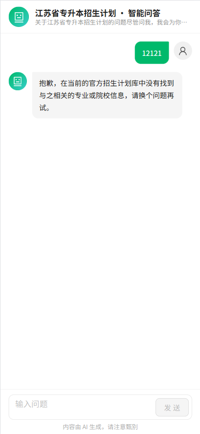
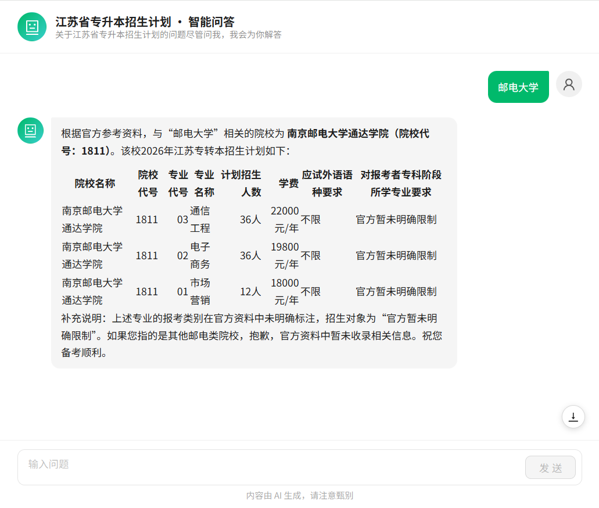

# intelligent-qa-frontend

智能问答系统前端项目，配套后端：[智能问答系统后端](https://github.com/huanganfree/intelligent-qa)

# 江苏省专转本 AI 智能问答系统

基于 RAG（Retrieval-Augmented Generation，检索增强生成）技术实现的 AI 智能问答 Demo，围绕江苏省专转本招生计划及相关信息构建知识库，支持用户通过自然语言提问，检索相关知识并生成 AI 回答。

本项目主要用于学习和实践 AI 应用开发，探索大语言模型、Embedding、向量数据库及 RAG 技术在垂直领域问答场景中的应用。

## 项目演示

- 在线体验：[点击访问](http://120.26.94.24/ha-project/aiQA/#/ai/qa)
- 项目类型：个人学习 Demo
- 项目状态：持续完善中

## 技术栈

### 前端

- Vue 3
- TypeScript
- Vite
- Pinia
- Vue Router

### 后端

- Node.js
- NestJS
- TypeScript
- Prisma
- PostgreSQL
- pgvector

### AI 技术

- DeepSeek：大语言模型（LLM）
- Embedding API：文本向量化
- RAG：检索增强生成
- Vector Search：向量相似度检索
- SSE：AI 回答流式输出

### 部署

- Docker
- Linux
- Nginx

## 核心功能

- **知识库数据导入**：支持 Excel 数据上传、解析及文本提取。
- **文本向量化**：调用 Embedding API，将知识库文本转换为向量并存储至 PostgreSQL。
- **向量检索**：基于 pgvector 实现语义相似度检索，召回与用户问题相关的知识内容。
- **RAG 智能问答**：结合检索结果构建 Prompt 上下文，调用大语言模型生成回答。
- **流式响应**：通过 SSE 实时接收并展示 AI 生成的回答。
- **问答交互**：提供面向用户的移动端问答界面。

## RAG 核心流程

```text
             知识库构建
                 |
           Excel 文件上传
                 |
             数据解析
                 |
            文本提取
                 |
          Embedding API
                 |
             向量化
                 |
        PostgreSQL + pgvector
                 |
                 v
             用户提问
                 |
          问题向量化
                 |
             向量检索
                 |
          召回相关知识
                 |
          构建 Prompt
                 |
          调用 DeepSeek
                 |
            SSE 流式输出
                 |
             AI 回答
```

## 项目架构

```text
前端 Vue 3
    |
    | HTTP / SSE
    v
后端 NestJS
    |
    ├── 文件上传与解析
    |
    ├── Embedding API
    |
    ├── RAG 检索与 Prompt 构建
    |
    ├── DeepSeek API
    |
    └── Prisma
          |
          v
    PostgreSQL + pgvector
```

## 项目中涉及的技术实践

### 1. RAG 检索增强生成

通过向量检索从知识库中召回与用户问题相关的内容，将检索结果作为上下文传递给大语言模型，减少模型脱离知识库内容回答问题的情况。

### 2. PostgreSQL + pgvector

使用 pgvector 扩展存储文本向量，通过向量距离计算实现语义相似度检索，并结合业务字段进行过滤。

### 3. SSE 流式响应

后端通过 Server-Sent Events 将模型生成的内容持续推送给前端，实现类似 AI 对话产品的逐步输出效果。

### 4. NestJS 后端开发

基于 NestJS 组织业务模块，实现文件上传、数据处理、向量检索、模型调用及流式响应等功能。

## 本地运行

### 环境要求

- Node.js 20+
- PostgreSQL
- pgvector 扩展
- npm 或 pnpm
- DeepSeek API Key
- Embedding API Key

## 项目说明

本项目是个人 AI 应用开发练习 Demo，主要用于探索 RAG、向量数据库、大语言模型 API 调用及流式响应等技术。

目前项目主要围绕江苏省专转本相关数据进行实践，不代表官方招生信息平台。AI 生成内容可能存在错误，实际招生政策、招生计划及录取信息请以江苏省教育主管部门及相关院校官方发布的信息为准。

项目仍有进一步优化空间，例如检索效果优化、Prompt 优化、知识库更新机制、异常处理及并发性能优化等。

## 学习目标

通过本项目实践以下技术：

- Node.js / NestJS 后端应用开发
- 大语言模型 API 集成
- Embedding 与文本向量化
- PostgreSQL + pgvector 向量检索
- RAG 应用开发流程
- SSE 流式数据传输
- Docker 容器化部署

## 图示（部分）



